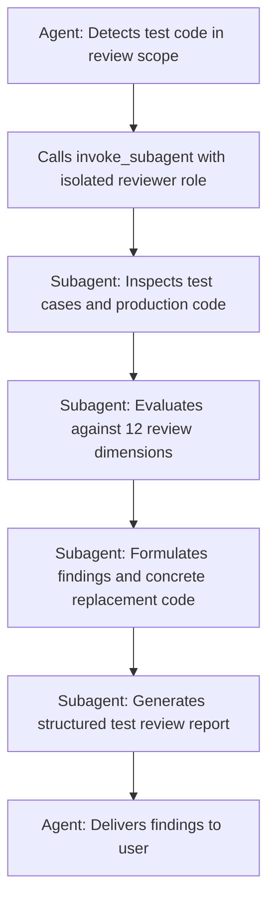

# Test Code Review Rules

Rigorous quality and design review for test code.

> [!IMPORTANT]
> **Must Use an Isolated Subagent for Review**: When reviewing test code, the
> main agent **MUST NOT** conduct the review directly in the main context. It
> MUST spawn an isolated subagent (e.g. `research` or `self`) via
> `invoke_subagent` with a clear role and prompt to perform the in-depth review
> and return structured findings.

---

## Review Dimensions & Checklist

The review subagent must inspect test code against each of the following 12
dimensions:

### 1. Overfitting

- **Symptoms**: Tests assert against hyper-specific hardcoded constants or magic
  inputs and cannot generalize to equivalent classes or standard inputs.
- **Risks**: Any trivial refactoring or dynamic data breaks the test, or
  production implementations can pass simply by returning hardcoded values
  (`if x == specific_val: return specific_val`).

### 2. Meaningless Checks

- **Symptoms**:
  - Only checking if a struct/object field exists or matches its type (in static
    languages or without serialization logic).
  - Only asserting default zero-values right after object instantiation (e.g.,
    `assert len(arr) == 0` or `assert obj.status == "DEFAULT"`), driving no
    actual behavior.
  - Calling functions solely to bump coverage percentages without valid
    assertions.

### 3. Bypass Branches

- **Symptoms**:
  - Injecting test-only bypass logic in production code or fixtures (e.g.,
    `if is_test: return mock_data`), skipping authentication, authorization, or
    core validation rules.
  - Designing test inputs that deliberately trigger early shortcut returns,
    circumventing core business logic.

### 4. Overly Broad Assertions

- **Symptoms**:
  - `assert result is not None`, `assert len(items) > 0`,
    `assert response.status_code == 200` (while completely ignoring response
    body content).
  - Using fuzzy matching or ignoring essential payload fields, allowing corrupt
    or erroneous outputs to pass undetected.

### 5. Guaranteed-Pass Tests (Tautology)

- **Symptoms**:
  - Tautological assertions (e.g., `assert True`, `assert 1 == 1`).
  - Assigning calculation results back to the expectation (self-verification:
    `actual = fn(x); expected = actual; assert actual == expected`).
  - Missing an explicit `fail()` in expected exception blocks, allowing tests to
    pass silently if no exception was raised.

### 6. Wrong Error Assertions

- **Symptoms**:
  - Catching generic errors (`except Exception:`, `catch (Throwable t)`) when
    expecting a specific exception type, causing unexpected null pointers or
    syntax crashes to masquerade as passing tests.
  - Verifying only that an exception occurred without asserting error types,
    error codes, or key error message strings.
  - Asserting error states disconnected from the actual business failure cause
    (e.g. asserting an invalid-argument error when the failure actually came
    from a missing DB configuration).

### 7. Mocking Business Logic Instead of I/O

- **Symptoms**:
  - Mocking domain services, business calculation routines, or state machine
    transitions, leaving only an empty glue call under test.
  - **Rule**: Only mock external, non-deterministic I/O (network requests,
    third-party APIs, wall clock, filesystem, message broker drivers). Business
    domain rules and transformations must execute real code.

### 8. Retroactive Code Catering

- **Symptoms**:
  - Tests written by blindly copying the current implementation's actual output
    (even when buggy) as the expected outcome, rather than deriving expectations
    from specifications.
  - When implementation bugs arise, mutating the test assertion to keep the
    build green rather than fixing the code.

### 9. Happy Path Only (Missing Boundaries, Errors & Irreversible Operations)

- **Symptoms**:
  - **Missing Boundary Cases**: Zero, empty collections, extrema (min/max),
    special characters, empty strings, concurrency boundaries.
  - **Unhandled Error States**: Timeouts, network disconnects, database
    connection drops, concurrency conflicts, retry exhaustion.
  - **Unhandled Irreversible Operations**: Destructive or irreversible actions
    (e.g., payment deductions, data deletion, message publishing, physical
    writes) without testing rollback mechanisms, idempotency, or transaction
    boundaries.

### 10. Timing & Execution Order Dependencies

- **Symptoms**:
  - **Sleep-based timing**: Using arbitrary delays (`time.sleep(1)`,
    `sleep(100ms)`) to wait for asynchronous tasks, event listeners, or message
    queues rather than polling with conditions (`await_until`), callbacks, or
    reactive notifications. Prone to race conditions under heavy system load.
  - **Inter-Test Order Coupling**: Test A mutates shared state/data and Test B
    assumes Test A runs first. Fails when executed in random order
    (`--random-order`) or in parallel.
  - **Race conditions**: Concurrency tests lacking synchronization barriers,
    making test outcomes reliant on OS thread scheduling speed.

### 11. Environment Pollution & Leftover Artifacts

- **Symptoms**:
  - Creating temporary files in the repository or `/tmp` without cleanup in
    teardown/finally blocks.
  - Mutating global state (e.g., `os.environ`, system properties, static
    singletons, global monkey patches) without restoring them.
  - Writing dirty data directly to shared databases without transaction
    rollbacks or isolated namespaces.

### 12. Non-Deterministic / Flaky Tests

- **Symptoms**:
  - Unmocked dependencies on system wall clocks (`datetime.now()`).
  - Relying on non-deterministic hash iteration or unsorted collections for
    sequence comparisons.
  - Using unseeded pseudo-random generators (`random()`).
  - Relying on live external networks or third-party service availability.

---

## Review Execution Workflow



### Subagent Invocation Prompt Template

```python
invoke_subagent(
    Role="Test Code Reviewer",
    TypeName="research", # or self
    Prompt="""
Perform an isolated quality and validity review of the test code below.
Target Test Files: [paths / diff range]
Production Code Context: [paths]

Strictly evaluate against all 12 test code smell dimensions:
1. Overfitting
2. Meaningless checks (asserting struct fields exist, default zero-values, etc.)
3. Bypass branches (test flags skipping core logic)
4. Overly broad assertions
5. Guaranteed-pass tests (tautology, missing fail())
6. Wrong error assertions (catching generic exceptions, detached error codes)
7. Mocking business logic instead of I/O
8. Retroactive code catering (matching buggy output instead of spec)
9. Happy path only (missing boundaries, error states, irreversible ops)
10. Timing & execution order dependencies (sleeps, race conditions, test order coupling)
11. Environment pollution & leftover artifacts
12. Non-deterministic / flaky tests (unseeded random, clock, map order)

Output requirements: Use the standard review output template. For each violation, specify location, rationale, offending snippet, and the concrete refactored code.
"""
)
```

---

## Output Template for Test Reviews

````markdown
## Test Code Review Report

### Overall Status: [Approved / Needs Improvement / Critical Risks]

---

### [Dimension # & Name] — [Short Issue Title]

**File**: `path/to/test_file.ext` (lines Lxx-Lyy)

**Category**: [Identified defect, e.g. "Overfitting / Asserting Default Values /
Mocking Business Logic"]

**Problem**: [Explain why this test is invalid, the escape risk it introduces,
or the pollution it causes]

**Current Code**:

```[lang]
// Offending test code snippet
```

**Recommended Replacement**:

```[lang]
// Robust, refactored test code snippet
```

---

### Summary

- **Total Issues Found**: N
- **Key High-Risk Vulnerabilities**: [List top 2-3 issues to address first]
- **Coverage & Edge-Case Recommendations**: [Suggestions for missing edge/error
  cases]
````
